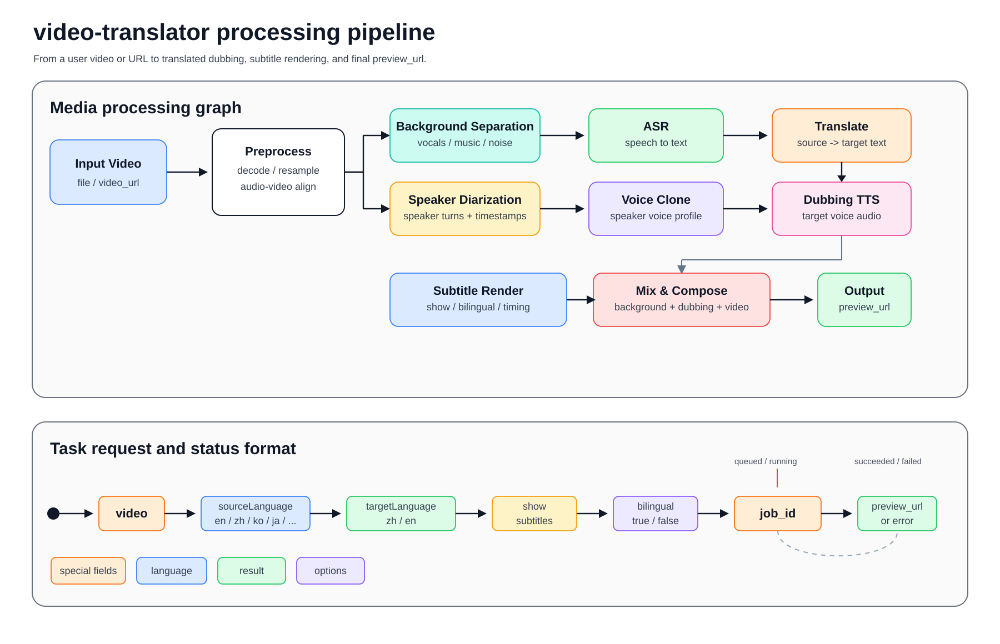

# video-translator

A skill for OpenClaw to translate/dub user videos via online service and return `preview_url`.

中文版: [README.zh-CN.md](README.zh-CN.md)

## Demo Video

https://github.com/user-attachments/assets/8f8e6307-7c09-40f1-981e-fdd118f400ef

## What It Does

- Accepts exactly one input source:
  - video file upload
  - public video URL
- Submits async job to remote service
- Polls job status until completion
- Returns final `preview_url` on success

## Workflow

1. Accept a local video file or `video_url`.
2. Run preprocessing, background separation, speaker diarization, ASR, translation, voice cloning, dubbing, subtitle rendering, and final mix/composition.
3. Submit an async job with `POST /video-trans/orchestrate`, then poll by `job_id`.
4. Return `preview_url` on success, or the API `error` on failure.

## Remote Service

- Base URL: `https://audiox-api-global.luoji.cn`
- Endpoints used:
  - `GET /video-trans/health`
  - `POST /video-trans/orchestrate`
  - `GET /video-trans/jobs/{job_id}`

## Required Credential

Set environment variable:

- `VIDEO_TRANSLATE_SERVICE_API_KEY`

The skill uses this key as:

- `Authorization: Bearer <api_key>`

## Model

`model` selects the AudioX product. Omit it to keep the original behaviour (`podcast`).

| `model` | Product | Source languages | Target languages |
| --- | --- | --- | --- |
| `podcast` (default) | 播客直译 | see direction rules below | `zh`, `en` |
| `pro` | AI 视频直译 Pro (keeps the original timbre) | `zh`, `ko`, `ja`, `en` | `zh`, `ko`, `en`, `fr`, `es`, `th`, `vi`, `lo` |
| `normal` | AI 视频直译 (similar voice) | `zh`, `ko`, `ja`, `en` | `zh`, `ko`, `en`, `fr`, `es`, `th`, `vi`, `lo` |

- Send `model=pro` when the user asks for Pro or to keep the original voice; `model=normal` for AI 视频直译.
- When the user wants a target language `podcast` cannot do (French, Thai, Vietnamese, Lao…), use `model=normal` and say so.
- `pro` / `normal` accept the same source and target (re-dub only) and require an `mp4` / `mov` / `webm` / `mkv` video.

## Languages

Always convert language names to ISO 639-1 codes: `zh`, `en`, `ko`, `ja`, `fr`, `ru`, `es`, `de`, `th`, `vi`, `lo`.

`model=podcast` has fixed directions:

- `targetLanguage=en` requires `sourceLanguage=zh` (Chinese video to English).
- `targetLanguage=zh` requires `sourceLanguage` in `en`, `ko`, `ja`, `fr`, `ru`, `es`, `de`.
- Default `targetLanguage=en`; default source is `zh` for `en` and `en` for `zh`.
- Other combinations (e.g. Korean to English) are rejected; offer `model=normal` instead.

`model=pro` / `normal`:

- `sourceLanguage` in `zh`, `ko`, `ja`, `en` (default `zh`).
- `targetLanguage` in `zh`, `ko`, `en`, `fr`, `es`, `th`, `vi`, `lo` (default `en`).

The service validates the same rules and answers `400` with the allowed values.

## Subtitles

- `show`: whether subtitles are shown in the output video, default `false`.
- `bilingual`: whether subtitles are bilingual, default `false`.
- For bilingual subtitles, send both `show=true` and `bilingual=true`.

## Billing

Jobs are billed in AudioX credits (积分) from the account that owns the API key: `podcast` at the
播客直译 rate, `pro` / `normal` at their model rates. `error` is `INSUFFICIENT_BALANCE` when the
balance runs out.

## Error Handling

- Missing/invalid API key:
  - CN users -> `https://luoji.cn/studio/api-keys`
  - non-CN users -> `https://luoji.cn/studio/api-keys?lang=en-US`
- Credits insufficient (`INSUFFICIENT_BALANCE`):
  - CN users -> `https://luoji.cn/studio/wallet`
  - non-CN users -> `https://luoji.cn/studio/wallet?lang=en-US`
- Other failures: return API `error` text directly.

## Runtime Requirements

- `curl`
- `python3`

## Files

- `SKILL.md`: skill behavior and invocation rules
- `agents/openai.yaml`: agent metadata
- `references/api-contract.md`: API contract
- `scripts/curl_examples.sh`: quick test script
- `README.zh-CN.md`: Chinese guide with diagrams
- `assets/readme/`: README assets, including the project header, a Whisper-style video translation pipeline diagram, and English and Chinese demo videos
