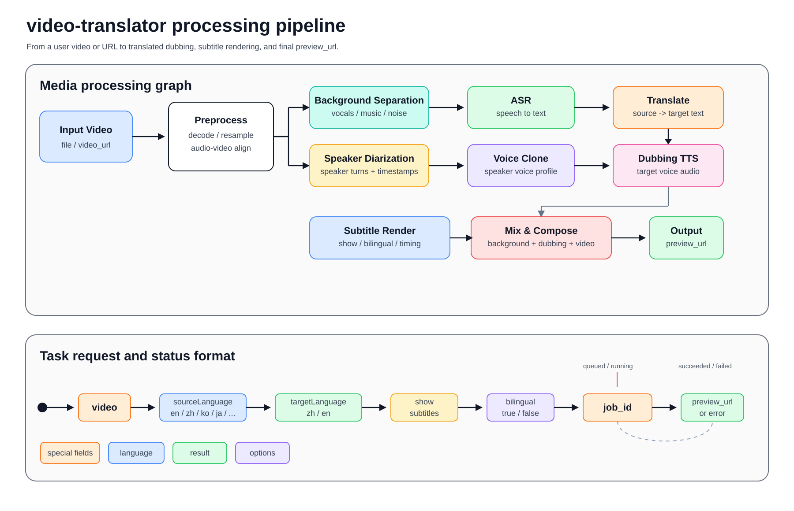

# video-translator

A skill for OpenClaw to translate/dub user videos via online service and return `preview_url`.

中文版: [README.zh-CN.md](README.zh-CN.md)

## Demo Video

https://github.com/user-attachments/assets/8f8e6307-7c09-40f1-981e-fdd118f400ef

## What It Does

- Accepts exactly one input source:
  - video file upload
  - public video URL
- Submits async job to remote service
- Polls job status until completion
- Returns final `preview_url` on success

## Workflow

1. Accept a local video file or `video_url`.
2. Run preprocessing, background separation, speaker diarization, ASR, translation, voice cloning, dubbing, subtitle rendering, and final mix/composition.
3. Submit an async job with `POST /video-trans/orchestrate`, then poll by `job_id`.
4. Return `preview_url` on success, or the API `error` on failure.

## Remote Service

- Base URL: `https://audiox-api-global.luoji.cn`
- Endpoints used:
  - `GET /video-trans/health`
  - `POST /video-trans/orchestrate`
  - `GET /video-trans/jobs/{job_id}`

## Required Credential

Set environment variable:

- `VIDEO_TRANSLATE_SERVICE_API_KEY`

The skill uses this key as:

- `Authorization: Bearer <api_key>`

## Target Language

Supported target languages:

- `zh` (Chinese)
- `en` (English)

Rules:

- If user specifies a target language, convert it to ISO 639-1 and send as `targetLanguage`.
- If user does not specify language, default to `en`.
- Only Chinese and English are valid target languages.

## Source Language

Supported source languages:

- `en` (English)
- `zh` (Chinese)
- `ko` (Korean)
- `ja` (Japanese)
- `fr` (French)
- `ru` (Russian)
- `es` (Spanish)
- `de` (German)

Rules:

- If user specifies a source language, convert it to ISO 639-1 and send as `sourceLanguage`.
- If source language is omitted, use `sourceLanguage=zh` when `targetLanguage=en`, and `sourceLanguage=en` when `targetLanguage=zh`.

## Subtitles

- `show`: whether subtitles are shown in the output video, default `false`.
- `bilingual`: whether subtitles are bilingual, default `false`.
- For bilingual subtitles, send both `show=true` and `bilingual=true`.

## Error Handling

- Missing/invalid API key:
  - CN users -> `https://luoji.cn`
  - non-CN users -> `https://luoji.cn?lang=en-US`
- Token insufficient:
  - CN users -> `https://luoji.cn`
  - non-CN users -> `https://luoji.cn?lang=en-US`
- Other failures: return API `error` text directly.

## Runtime Requirements

- `curl`
- `python3`

## Files

- `SKILL.md`: skill behavior and invocation rules
- `agents/openai.yaml`: agent metadata
- `references/api-contract.md`: API contract
- `scripts/curl_examples.sh`: quick test script
- `README.zh-CN.md`: Chinese guide with diagrams
- `assets/readme/`: README assets, including the project header, a Whisper-style video translation pipeline diagram, and English and Chinese demo videos
