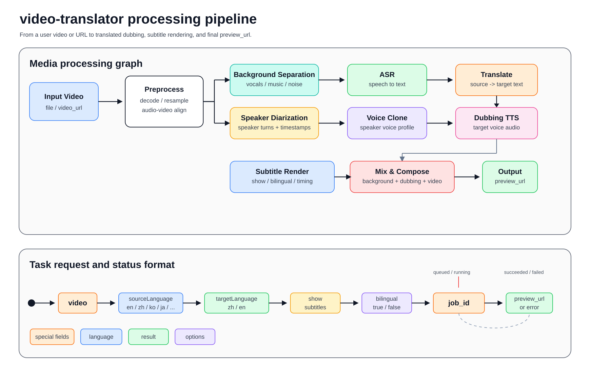

# video-translator 中文说明

`video-translator` 是一个用于调用在线视频翻译 / 配音服务的 Codex skill。它接收本地视频文件或可访问的视频 URL，提交异步翻译任务，轮询任务状态，并在成功后返回最终的 `preview_url`。

## 演示视频

https://github.com/user-attachments/assets/e43f7d48-e07e-4288-9261-0db247a54f14

## 适合什么场景

- 视频直译：把用户提供的视频翻译成目标语言。
- 视频配音：通过线上服务生成翻译后视频。
- 字幕翻译出片：按需开启单语或双语字幕。
- 自动返回预览：任务完成后把 `preview_url` 交给用户。

## 工作流程



1. 接收本地视频文件或 `video_url`。
2. 进行预处理、背景音分离、说话人分离、ASR、翻译、声音克隆、配音生成、字幕渲染和最终混音。
3. 调用 `POST /video-trans/orchestrate` 提交异步任务，并使用 `job_id` 轮询状态。
4. 成功后返回 `preview_url`，失败时返回接口 `error`。

## 固定服务信息

- Base URL：`https://audiox-api-global.luoji.cn`
- 健康检查：`GET /video-trans/health`
- 提交任务：`POST /video-trans/orchestrate`
- 查询任务：`GET /video-trans/jobs/{job_id}`

## 凭证要求

运行前需要配置环境变量：

```bash
export VIDEO_TRANSLATE_SERVICE_API_KEY="你的 API Key"
```

请求时使用：

```http
Authorization: Bearer <api_key>
```

API Key 在 `https://luoji.cn/studio/api-keys` 创建。缺少或无效时引导用户去该页面；积分不足（`error` 为 `INSUFFICIENT_BALANCE`）时引导到 `https://luoji.cn/studio/wallet` 充值（非中国地区加 `?lang=en-US`）。任务按积分计费：`podcast` 按「播客直译」费率，`pro` / `normal` 按对应模型费率。

## 输入方式

二选一即可：

- 本地视频文件：multipart 字段名固定为 `video`
- 视频 URL：JSON 字段名为 `video_url`，需要是可访问的 `http(s)` 链接

辅助参数：

- `model`：译制模型，`podcast`（默认，播客直译）/ `pro`（AI 视频直译 Pro，保留原声音色）/ `normal`（AI 视频直译，相似音色）；不传等于 `podcast`
- `targetLanguage` / `target_language`：目标语言，默认 `en`
- `sourceLanguage` / `source_language`：源语言，未传时按模型和目标语言推断
- `show`：是否显示字幕，默认 `false`
- `bilingual`：是否双语字幕，默认 `false`

## 语言规则

语言一律转成 ISO 639-1 代码：中文 `zh`、英文 `en`、韩语 `ko`、日语 `ja`、法语 `fr`、俄语 `ru`、西班牙语 `es`、德语 `de`、泰语 `th`、越南语 `vi`、老挝语 `lo`。

`model=podcast`（默认）方向固定：

- `targetLanguage=en`：只能 `sourceLanguage=zh`（中文视频译成英文）
- `targetLanguage=zh`：`sourceLanguage` 只能是 `en` / `ko` / `ja` / `fr` / `ru` / `es` / `de`
- 未指定目标语言时用 `en`；未指定源语言时，目标 `en` 用 `zh`，目标 `zh` 用 `en`
- 其他组合（例如韩语译成英文）会被拒绝，可改用 `model=normal`

`model=pro` / `normal`：

- `sourceLanguage` 只能是 `zh` / `ko` / `ja` / `en`，默认 `zh`
- `targetLanguage` 只能是 `zh` / `ko` / `en` / `fr` / `es` / `th` / `vi` / `lo`，默认 `en`
- 允许源目标相同（只重新配音）；视频必须是 `mp4` / `mov` / `webm` / `mkv`

接口按同样规则校验，不符合时返回 `400` 并说明允许的取值。

## 字幕规则

- 默认不显示字幕：`show=false`、`bilingual=false`
- 用户要求显示字幕、带字幕或烧字幕时：传 `show=true`
- 用户要求双语字幕时：传 `show=true` 且 `bilingual=true`
- 用户没有提出字幕需求时，不主动开启字幕

## 任务状态

处理逻辑：

1. 先调用健康检查接口。
2. 提交任务并从响应中读取 `job_id`。
3. 使用 `job_id` 轮询任务状态。
4. `queued` / `running` 时继续轮询。
5. `succeeded` 时返回 `preview_url`。
6. `failed` 时返回接口里的 `error` 文本。

## 使用脚本快速测试

脚本路径：

```bash
scripts/curl_examples.sh
```

URL 输入示例：

```bash
VIDEO_TRANSLATE_SERVICE_API_KEY="你的 API Key" \
  ./scripts/curl_examples.sh "https://example.com/input.mp4" en zh false false
```

本地文件输入示例：

```bash
VIDEO_TRANSLATE_SERVICE_API_KEY="你的 API Key" \
  ./scripts/curl_examples.sh "/abs/path/to/input.mp4" zh en true true
```

AI 视频直译（普通版）译成泰语：

```bash
VIDEO_TRANSLATE_SERVICE_API_KEY="你的 API Key" \n  ./scripts/curl_examples.sh "/abs/path/to/input.mp4" th zh false false normal
```

参数顺序：

```text
<视频 URL 或本地绝对路径> [targetLanguage] [sourceLanguage] [show] [bilingual] [model]
```

## 文件说明

- `SKILL.md`：Codex 调用这个 skill 时读取的核心规则
- `README.md`：英文说明
- `README.zh-CN.md`：中文说明
- `agents/openai.yaml`：界面元数据
- `references/api-contract.md`：接口契约
- `scripts/curl_examples.sh`：快速调试脚本
- `assets/readme/`：README 资源，包含项目头图、Whisper 风格的视频翻译流程图和中英文演示视频

## 安全说明

- 该 skill 会调用外部服务 `https://audiox-api-global.luoji.cn`。
- 不要把 `VIDEO_TRANSLATE_SERVICE_API_KEY` 写入仓库。
- 失败时优先返回接口原始 `error` 文本，避免编造处理结果。
